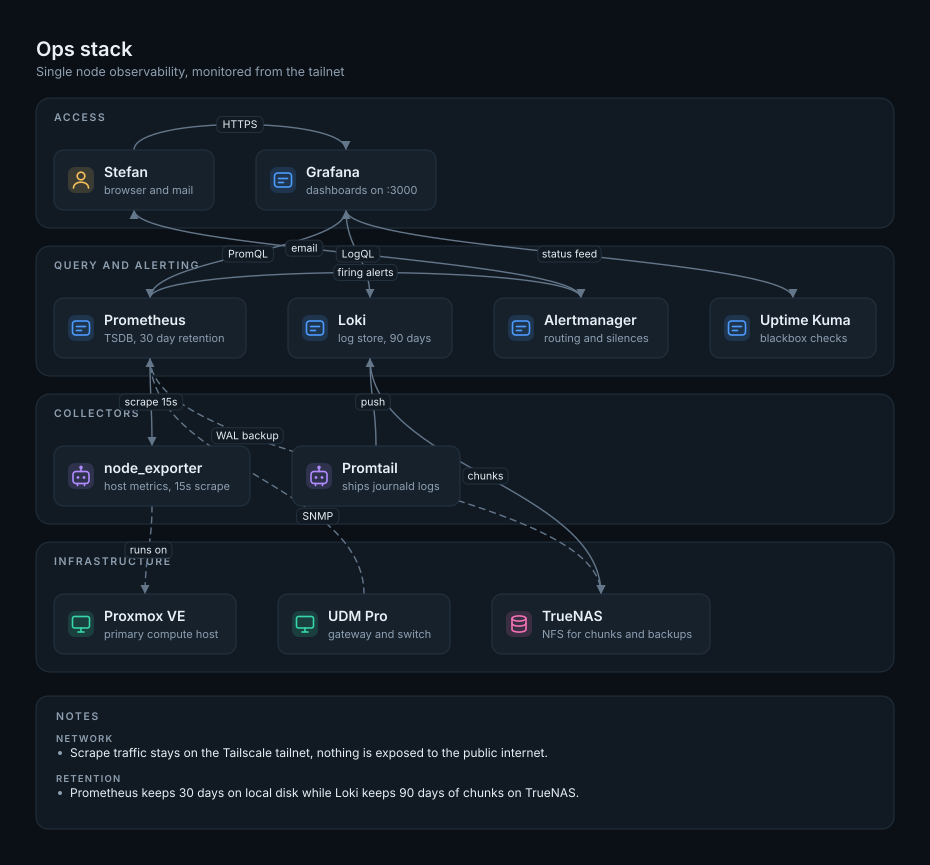

# diagrams-from-json

Turn a YAML or JSON spec into a clean SVG architecture diagram. No browser, no Graphviz, no external assets: a small Python package in, one standalone SVG out.

I built this because I kept redrawing the same home lab and ops diagrams in editors that export a megabyte of metadata for six boxes. A spec file reviews well in a pull request, diffs cleanly, and takes seconds to change.



## Install

```bash
pip install git+https://github.com/StefanYasin/diagrams-from-json.git
```

From a clone, with the test dependencies:

```bash
git clone https://github.com/StefanYasin/diagrams-from-json.git
cd diagrams-from-json
python -m venv .venv
.venv/Scripts/activate          # Windows
source .venv/bin/activate       # macOS and Linux
pip install -e ".[dev]"
```

Python 3.9 or newer. The only runtime dependency is PyYAML.

## Use

```bash
diagrams-from-json examples/ops-stack.yml -o ops-stack.svg
diagrams-from-json examples/ops-stack.yml -o ops-stack-light.svg --light
```

The default theme is dark. `--light` switches the palette, `-o -` writes the SVG to stdout, and leaving out `-o` writes next to the spec with an `.svg` extension.

## Spec

```yaml
version: 1
title: Ops stack
subtitle: Single node observability
theme: dark              # dark (default) or light

layers:                  # band order, top to bottom
  - id: access
    label: Access
  - id: infra
    label: Infrastructure

nodes:
  - id: grafana
    label: Grafana
    type: service        # service, device, user, agent, db
    layer: access
    note: dashboards on :3000
  - id: nas
    type: db
    layer: infra

edges:
  - from: grafana
    to: nas
    label: chunks
    style: solid         # solid or dashed
    bidirectional: false

notes:
  - label: network
    text: Traffic stays on the private tailnet.
```

| Field | Rules |
| --- | --- |
| `version` | Optional. Must be `1` when present. |
| `title` | Required, non-empty. Rendered top left and as the SVG title. |
| `subtitle` | Optional second line. |
| `theme` | Optional `dark` or `light`. The CLI flag wins over this. |
| `layers` | Optional list of `id` and `label`. Order is band order. Ids match `[a-z0-9][a-z0-9._-]*`. |
| `nodes` | Required, non-empty. Each has `id`, `type`, optional `label`, `layer`, `note`. `label` defaults to the id. Nodes without a layer land in a `General` band. |
| `edges` | Optional. `from` and `to` must be declared node ids. `label`, `style` and `bidirectional` are optional. |
| `notes` | Optional. Either a string or a mapping with `text` and an optional `label`. |

Node types map to a glyph and an accent colour:

- `service`: a box with status lines, for anything that answers a request.
- `device`: a monitor, for physical or virtual hardware.
- `user`: a person.
- `agent`: a small robot, for collectors and daemons.
- `db`: a cylinder, for storage.

## Layout

Layout is deterministic on purpose. There is no solver: nodes keep the order they appear in the spec, up to four per row, and rows wrap inside their band. Edges run vertically between bands and arc above the row for neighbours in the same band. Edge labels slide along their curve until they stop covering a box. The same spec always produces the same bytes, which is what makes golden file tests possible.

## Module

```python
from diagrams_from_json import SpecError, load_spec, render_spec, write_svg

spec = load_spec("examples/ops-stack.yml")
svg = render_spec(spec)                 # dark by default
write_svg(spec, "ops-stack.svg")        # or write it yourself
light = render_spec(spec, theme="light")
```

`render_spec` validates its input, so it accepts either a raw dict or the normalised spec returned by `load_spec`. Validation failures raise `SpecError`, which carries one message per problem, each with the path of the field that caused it:

```text
nodes[2].type: must be one of: service, device, user, agent, db, got 'queue'
edges[0].to: unknown node 'prometheous'
```

## Tests

```bash
python -m pytest
```

67 tests cover schema validation, geometry invariants (boxes stay inside their band, no node overlaps, every arrow lands on a node border, labels never cover a box), golden SVG output for the examples, and the CLI. Regenerate the golden files after an intentional layout change:

```bash
python scripts/build_goldens.py
```

## Limits

- No automatic graph layout. If the order is wrong, change the spec.
- Text widths are estimated from Helvetica metrics, so a label can be a few pixels tighter or looser in another font.
- One theme per render. No CSS variables or external stylesheet.

## License

MIT

Built by [Stefan Yasin](https://stefanyasin.github.io/)
